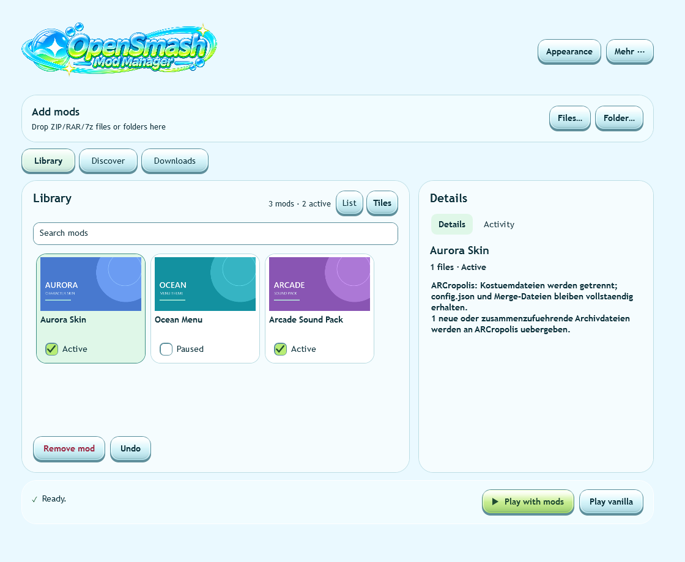
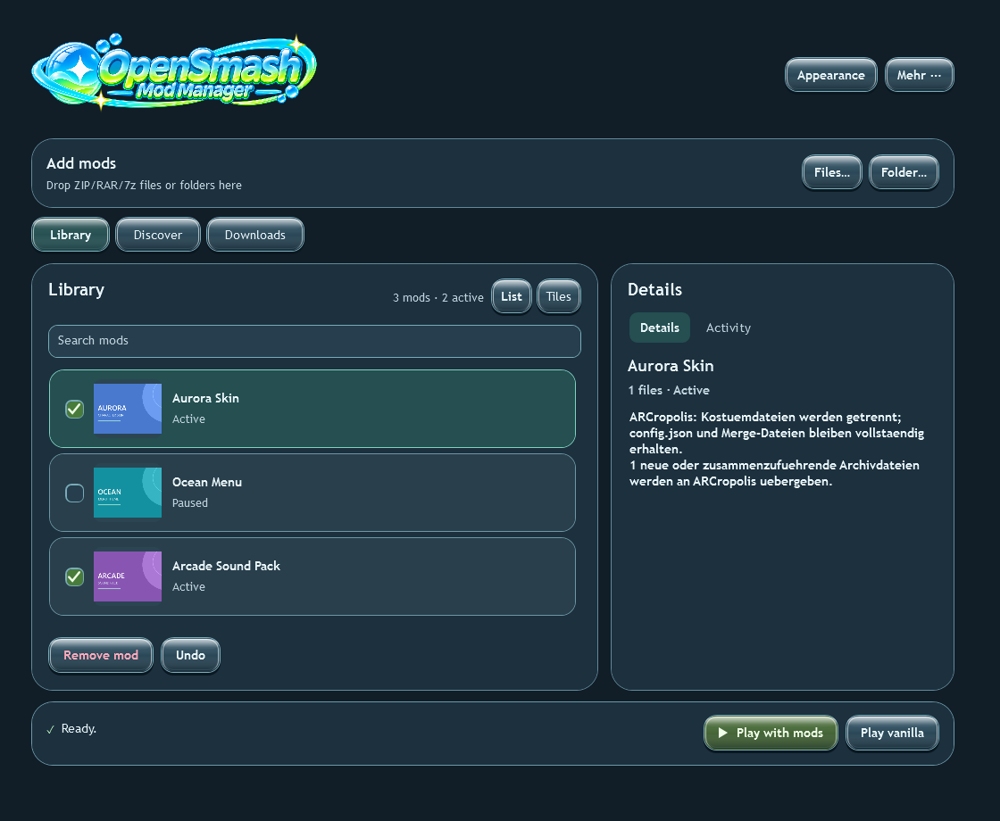
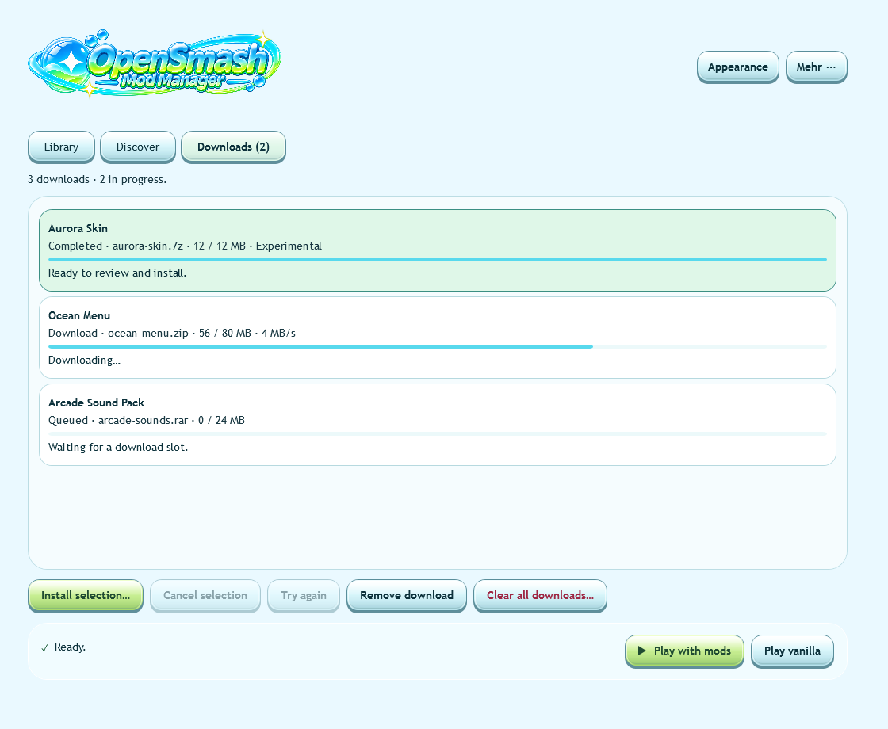

<p align="center">
  
</p>

# OpenSmash Mod Manager

A small Windows app for installing and managing OpenSmash mods. This personal
project was built with help from ChatGPT and Codex.

## Screenshots

Examples use demo mods and sample artwork.

**Library (tiles)**



**Library (list)**



**Downloads**



## Setup and use

Requires 64-bit Windows 10 (2004+) or Windows 11, .NET Framework 4.8+,
PowerShell 5.1 and your own complete OpenSmash 13.0.5 installation.
Local mod builds also need OpenSmash's
build inputs, LLVM/Clang, Microsoft C++ Build Tools and the Windows SDK.

1. Extract an [installer release](https://github.com/TRLLZR/OpenSmash-Mod-Manager/releases)
   and run `Setup.exe`, or build the current source below.
2. Connect your OpenSmash folder.
3. Drop ZIP/RAR/7z archives or folders into the library, or download through Discover.
4. Review the import preview, enable your mods and choose Play with mods.

Pause mods to disable them, use Undo to restore a change, or choose Play vanilla.
The manager keeps your game saves and settings. Back up anything important.
Mod lists can be shared without bundling the mod files.

## Updates

The installed manager checks GitHub Releases on startup, downloads a newer stable
installer, verifies its SHA-256 and reopens after installation. You can skip the
download. Install an updater-enabled build once to enable this on older copies.
To publish a new version, update the build version and create
`release/vX.Y.Z` from the verified main commit. GitHub builds and publishes the
guided Setup executable, installer ZIP and matching source ZIP.

## Compatibility

Standard ARCropolis assets and locally translatable Skyline NRO plugins are
supported. A costume skin does not create a new fighter; moveset skins need their
base moveset. See [Mod setup](docs/MODS.md) for overlays, framework versions and
optional Training Modpack support.

Not every plugin or mod combination works. Matching game/framework versions are
required; a successful import or build alone does not prove gameplay compatibility.
Native `fighter.json`/Windows-DLL mod packages, encrypted archives and multi-volume
archives are not supported. Large first builds can take several minutes.

## Build from source

Use a separate Python 3.14+ on Windows, from the repository root:

```powershell
python audit_publication.py
python prepare_runtime.py
powershell.exe -NoProfile -ExecutionPolicy Bypass -File installer/BuildLauncher.ps1
installer/runtime/python.exe -B -m unittest discover -s installer -p 'test_*.py'
python -m unittest test_publication
installer/runtime/python.exe -B build_release.py
```

The installer ZIP is written to the repository root. Source changes may be newer
than the published installer. `python export_source.py` creates a clean source ZIP;
include it alongside the installer when sharing a build, as it contains the
matching 7-Zip source.

For bug reports, include your version, steps to reproduce and a short redacted log.
Do not commit game data, keys, saves, downloaded mods or personal configuration.

## Licenses

Application code: [MIT](LICENSE.txt). Bundled components and artwork:
[third-party notices](THIRD_PARTY_NOTICES.txt). The separate OpenSmash source patch
is [GPL-3.0](compatibility/opensmash/NOTICE.md).
